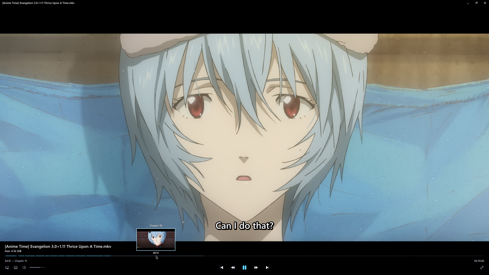

# ModernX

> [!NOTE]
> This script is updated frequently at [mpvconfig](https://github.com/zydezu/mpvconfig), stable builds are released here in the [releases](https://github.com/zydezu/ModernX/releases) tab.

A modern OSC for [mpv](https://mpv.io/) that aims to mirror the functionality of MPV's stock OSC while with a more modern-looking interface.



> [!NOTE]
> This script is included in my [mpvconfig](https://github.com/zydezu/mpvconfig), check that repository for a full mpv configuration

## Additional Features

This fork changes / includes the following:

- Layouts: `original` (default) and `reduced`, plus ModernZ `default` / `compact` / `mini` / `seekbar` (images use the image viewer layout)
- Compact mode (default **on**) — jump merged into chapter buttons
- Description line on `original` (web metadata / local stats); scrolling overlay with link cycle (`Tab` / `Shift+Tab` / `Enter`)
- YouTube view/like stats in the title; experimental comments (`show_youtube_comments`, default **on**)
- Download button for web videos (yt-dlp + ffmpeg)
- Key pack (default **on**): `m` / `MENU` / `Ctrl+p` open the interactive menu; `Ctrl+m` mutes; `d` description; `DEL` theatre; chapter/playlist helpers
- Theatre mode (`auto` ↔ `never`) also via `script-binding modernx/theatre`
- Icons: single `modernx-icons.ttf` with `icon_theme` (`fluent` / `material`) and `icon_style` (`mixed` / `filled` / `outline`)
- Secondary subtitle button, window-control toggles/size, SponsorBlock paint, A-B loop indicator, late-start chapters
- Optional `save_button` for `save-position-on-quit` (does **not** rewrite `mpv.conf`)
- Seekbar colours aligned to zydezu (`#1D96F5`); no visible seek handle by default (`seek_handle_size=0`)
- Deadzone + `keep_with_cursor` (not zydezu `bottom_hover`)
- Many more configurable options — see [docs/USER_OPTS.md](docs/USER_OPTS.md)

## Installation

Locate your MPV folder. It is typically located at `\%APPDATA%\mpv\` on Windows and `~/.config/mpv/` on Linux/macOS. See the [Files section](https://mpv.io/manual/master/#files) in mpv's manual for more info.

> [!NOTE]
> Create these folders if you don't have them already

Place `modernx.lua` into your mpv `scripts/` folder, remove any previous OSC scripts.

Then place the icon font in the `fonts/` folder: **`modernx-icons.ttf`** (shipped with this repo — not zydezu’s `fluent-system-icons.ttf`).

Optional:

| File | Destination |
| --- | --- |
| `modernx.conf` | `script-opts/` |
| `extras/locale/modernx-locale.json` | `script-opts/` |

Example layout:

```
mpv/
├── fonts/modernx-icons.ttf
├── script-opts/modernx.conf
├── script-opts/modernx-locale.json   # optional
└── scripts/modernx.lua
```

### mpv.conf

Add the following lines to your `mpv.conf` file.

> [!NOTE]
> Please note that `.conf` files use yes/no in place of true/false

```editorconfig
osc=no
border=no # optional — if you don't want to see the OS border
```

Requires **mpv ≥ 0.38** for the interactive menu / `select` bindings used by the key pack.

## SponsorBlock

To allow SponsorBlock segments to show up on the timeline, copy the companion script from this repo:

```
extras/sponsorblock/sponsorblock.lua  →  scripts/sponsorblock.lua
```


## Configuration

Create a `modernx.conf` file and place it in the `script-opts/` folder (create the folder if you haven't already). A plethora of options can be changed; the defaults below match this fork. Full tables (including mouse commands): [docs/USER_OPTS.md](docs/USER_OPTS.md).

### Example

Here is an example of a configuration file, which would be placed in `script-opts/modernx.conf`:

```editorconfig
compact_mode=no
info_button=yes
title_font_size=20
seek_handle_size=0
```

### Configurable Options

The default options are shown below:

```lua
-- Parameters
-- default user option values
-- change them using modernx.conf
local user_opts = {
    -- Language and display
    language = "default",                  -- set language
    layout = "original",                   -- set layout: default, compact, mini, seekbar, original, reduced
    layout_option = "",                    -- legacy alias; copied to layout only when layout is still the default
    icon_theme = "fluent",                 -- set icon theme. accepts "fluent" or "material"
    icon_style = "mixed",                  -- "mixed", "filled", "outline"
    font = "mpv-osd-symbols",              -- font for the OSC (default: mpv-osd-symbols or the one set in mpv.conf)

    idlescreen = true,                     -- show mpv logo when idle
    window_top_bar = "auto",               -- show OSC window top bar: "auto", "yes", or "no" (borderless/fullscreen)
    showwindowed = true,                   -- show OSC when windowed
    showfullscreen = true,                 -- show OSC when fullscreen
    showonselect = false,                  -- show OSC when a select menu is open
    showonpause = false,                   -- show OSC when paused
    keeponpause = "no",                    -- keep OSC visible while paused: "no", "bottombar", "both"
    greenandgrumpy = false,                -- disable Santa hat in December

    -- OSC behaviour and scaling
    hidetimeout = 1500,                    -- time (in ms) before OSC hides if no mouse movement
    keep_with_cursor = true,               -- keep OSC visible while cursor hovers over bottom or top bar
    fadeduration = 150,                    -- fade-out duration (in ms), set to 0 for no fade
    fadein = true,                         -- whether to enable fade-in effect
    minmousemove = 0,                      -- minimum mouse movement (in pixels) required to show OSC
    deadzonesize = 0.75,                   -- size of the deadzone (0.0 = whole screen, 1.0 = no deadzone)
    deadzone_hide = "instant",             -- hide behavior when cursor enters deadzone or leaves window: "instant" or "timeout"
    osc_on_seek = false,                   -- show OSC when seeking
    seek_resets_hide_timeout = true,       -- seeking resets the OSC hide timeout (independent of osc_on_seek show)
    osc_on_start = "both",                 -- show OSC on start of every file ("no", "bottom", "top", "both")
    mouse_seek_pause = true,               -- pause video while seeking with mouse move (on button hold)
    force_seek_tooltip = false,            -- force show seekbar tooltip on mouse drag, even if not hovering seekbar

    vidscale = "auto",                     -- scale osc with the video
    scalewindowed = 1.0,                   -- osc scale factor when windowed
    scalefullscreen = 1.0,                 -- osc scale factor when fullscreen
    scale_forced_window = 1.0,             -- osc scale factor when forced (no video, e.g. music files)

    -- Elements display
    show_title = true,                     -- show title in the OSC
    title = "${media-title}",              -- title: "${media-title}" or "${filename}"
    dynamic_title = true,                  -- use ${media-title} when it differs from filename (URLs/audio)
    title_font_size = 24,                  -- title font size
    truncate_title = false,                -- truncate title with ellipsis if it overflows
    chapter_title_font_size = 16,          -- chapter title font size

    cache_info = false,                    -- show cached time information
    cache_info_speed = false,              -- show cache speed per second
    cache_info_font_size = 12,             -- font size of the cache information

    show_chapter_title = true,             -- show chapter title
    chapter_hover_title = false,           -- while scrubbing (no thumbfast): show hovered chapter in main title
    chapter_hover_subtitle = true,         -- while scrubbing (no thumbfast): show hovered chapter in chapter title row
    chapter_above_title = false,           -- show chapter above title
    chapter_fmt = "%s",                    -- format for chapter display on seekbar hover (set to "no" to disable)

    timecurrent = true,                    -- show current time instead of remaining time
    timems = false,                        -- show timecodes with milliseconds
    unicodeminus = false,                  -- use the Unicode minus sign in remaining time
    time_format = "dynamic",               -- "dynamic" or "fixed". dynamic shows MM:SS when possible, fixed always shows HH:MM:SS
    time_font_size = 16,                   -- font size of the time display

    tooltip_font_size = 14,                -- tooltips font size
    speed_font_size = 16,                  -- speed button font size

    -- Description, links, web stats, and comments
    show_description = true,               -- description on web videos, or metadata/stats on local files
    show_file_size = true,                 -- include the file size in the description
    description_font_size = 19,            -- font size of the description line under the title
    description_alpha = 100,               -- alpha of the scrolling description background
    scrolling_speed = 40,                  -- scroll step for the description/comment overlay
    date_format = "%Y-%m-%d",              -- metadata date format (os.date)
    title_youtube_stats = true,            -- append YouTube view/like counts to the window title
    show_youtube_comments = true,          -- EXPERIMENTAL YouTube comments (zydezu default)
    comments_path = "~/Pictures/mpv/comments", -- download path for the comment JSON file

    -- Title bar settings
    show_window_title = true,              -- show window title in borderless/fullscreen mode
    window_controls_title = "${filename}", -- title bar format (expand-text); used when show_window_title is on
    window_title_font_size = 26,           -- window title font size
    window_controls = true,                -- show window controls (close, minimize, maximize) in borderless/fullscreen
    window_close_button = true,            -- show close window control
    window_min_button = true,              -- show minimize window control
    window_max_button = true,              -- show maximize window control
    windowcontrols_independent = true,     -- show window controls (top bar) and bottom bar independently on hover

    -- Subtitle and OSD display settings
    sub_margins = true,                    -- raise subtitles above the OSC when shown
    osd_margins = false,                   -- adjust OSD to not overlap with OSC
    dynamic_margins = true,                -- update margins dynamically with OSC visibility

    -- Buttons display and functionality
    subtitles_button = true,               -- show the subtitles menu button
    secondary_subtitles_button = true,     -- show the secondary subtitles menu button
    audio_tracks_button = true,            -- show the audio tracks menu button
    compact_mode = true,                   -- merge jump into chapter_prev/chapter_next (same seek bindings on every layout)
    jump_buttons = true,                   -- show the jump backward and forward buttons
    jump_amount = 10,                      -- change the jump amount in seconds
    jump_more_amount = 60,                 -- change the jump amount in seconds on right click
    jump_icon_number = true,               -- show different icon when jump_amount is set to 5, 10, or 30
    jump_mode = "relative",                -- seek mode for jump buttons: "relative" or "exact"
    jump_softrepeat = true,                -- enable continuous jumping when holding down seek buttons
    chapter_skip_buttons = true,           -- show the chapter skip backward and forward buttons
    chapter_softrepeat = false,            -- continuous chapter skip while holding chapter buttons (non-compact)
    track_nextprev_buttons = true,         -- show next/previous playlist track buttons

    volume_control = true,                 -- show mute button and volume slider
    volume_slider = true,                  -- show the volume slider (requires volume_control)
    volume_control_type = "linear",        -- volume scale type: "linear" or "logarithmic"
    volumebar_unmute_on_click = false,     -- unmute audio when adjusting volume slider with left click
    playlist_button = true,                -- show playlist button
    hide_empty_playlist_button = false,    -- hide playlist button when no playlist exists
    gray_empty_playlist_button = false,    -- gray out the playlist button when no playlist exists

    fullscreen_button = true,              -- show fullscreen toggle button
    info_button = true,                    -- show info button
    ontop_button = false,                  -- show window on top button
    ontop_in_topbar = false,               -- move ontop button to top bar when ontop is active
    screenshot_button = false,             -- show screenshot button
    screenshot_flag = "subtitles",         -- screenshot mode: "subtitles", "video", "window", "each-frame" (+ optional +each-frame)
    save_button = false,                   -- show save-position-on-quit toggle (BlueEdition-inspired; does not rewrite mpv.conf)

    download_button = true,                -- show download button on web videos (requires yt-dlp and ffmpeg)
    download_path = "~/Pictures/mpv/",     -- default download directory for videos (https://mpv.io/manual/master/#paths)
    ytdl_format = "",                      -- optional yt-dlp args for download button; empty uses mpv ytdl-format

    loop_button = false,                   -- show file loop button
    shuffle_button = false,                -- show shuffle button
    speed_button = true,                   -- show speed control button

    buttons_always_active = "none",        -- force buttons to always be active. can add: playlist_prev, playlist_next

    playpause_size = 30,                   -- icon size for the play/pause button
    midbuttons_size = 24,                  -- icon size for the middle buttons
    sidebuttons_size = 24,                 -- icon size for the side buttons
    button_padding = 0,                    -- extra gap; mid/side steps grow with icon sizes (#73)
    windowcontrols_size = 25,              -- icon size for the window controls (close, maximize, minimize)

    zoom_control = true,                   -- show zoom controls in image viewer mode
    zoom_in_max = 4,                       -- maximum zoom in value
    zoom_out_min = -1,                     -- minimum zoom out value

    -- Colors and style
    osc_color = "#000000",                 -- accent color of the OSC and title bar
    window_title_color = "#FFFFFF",        -- color of the title in borderless/fullscreen mode
    window_controls_color = "#FFFFFF",     -- color of the window controls (close, minimize, maximize) in borderless/fullscreen mode
    windowcontrols_close_hover = "#E81123", -- color of close window control on hover
    windowcontrols_max_hover = "#53A4FC",  -- color of maximize window controls on hover (zydezu window_controls_minmax_hover)
    windowcontrols_min_hover = "#43CB44",  -- color of minimize window controls on hover
    title_color = "#FFFFFF",               -- color of the title
    cache_info_color = "#FFFFFF",          -- color of the cache information
    seekbar_cache_color = "#1D96F5",       -- color of the cache ranges on the seekbar
    seekbarfg_color = "#1D96F5",           -- color of the seekbar progress
    seekbarbg_color = "#FFFFFF",           -- color of the remaining seekbar
    seek_handle_color = "#088CC9",         -- color of the seekbar handle (BlueEdition)
    seek_handle_border_color = "#328BFF",  -- inner border color drawn inside the seekbar handle (set to "disable" to disable)
    volumebar_match_seek_color = false,    -- match volume bar color with seekbar color (ignores side_buttons_color)
    time_color = "#FFFFFF",                -- color of the timestamps (below seekbar)
    chapter_title_color = "#FFFFFF",       -- color of the chapter title
    side_buttons_color = "#FFFFFF",        -- color of the side buttons (audio, subtitles, playlist, etc.)
    middle_buttons_color = "#FFFFFF",      -- color of the middle buttons (skip, jump, chapter, etc.)
    playpause_color = "#FFFFFF",           -- color of the play/pause button
    held_element_color = "#999999",        -- color of the element when held down (pressed)
    hover_effect_color = "#FFFFFF",        -- color of a hovered button when hover_effect includes "color"
    thumbnail_box_color = "#FFFFFF",       -- color of the background for thumbnail box
    thumbnail_box_outline = "#000000",     -- color of the border outline for thumbnail box
    nibble_color = "#1D96F5",              -- color of chapter nibbles on the seekbar
    nibble_current_color = "#9D96f5",      -- color of the current chapter nibble on the seekbar
    ab_loop_color = "#2596be",             -- color of the A/B loop range on the seekbar

    -- SponsorBlock (needs extras/sponsorblock/sponsorblock.lua)
    show_sponsorblock_segments = true,                               -- show SponsorBlock segments on the seekbar
    add_sponsorblock_chapters = true,      -- keep [SponsorBlock] chapters in chapter-list; false strips them
    -- comma-separated categories drawn on the seekbar (empty = all known colors)
    sponsor_types = "sponsor,intro,outro,interaction,selfpromo,preview,music_offtopic,filler",
    sponsorblock_seek_range_alpha = 75,                              -- transparency of SponsorBlock segments
    sponsorblock_sponsor_color = "#00D400",                          -- color for sponsors
    sponsorblock_intro_color = "#00FFFF",                            -- color for intermission/intro animations
    sponsorblock_outro_color = "#0202ED",                            -- color for endcards/credits
    sponsorblock_interaction_color = "#CC00FF",                      -- color for interaction reminders (subscribe, etc.)
    sponsorblock_selfpromo_color = "#FFFF00",                        -- color for unpaid/self promotion
    sponsorblock_preview_color = "#008FD6",                          -- color for preview/recap segments
    sponsorblock_music_offtopic_color = "#FF9900",                   -- color for non-music sections in music videos
    sponsorblock_filler_color = "#7300FF",                           -- color for filler content/tangents
    sponsorblock_edge_tolerance = 3,        -- extend segments and chapters this close to the end (seconds)
    show_sponsorblock_segment_name_on_hover = false,                 -- segment type under seekbar hover time (ModernX)
    show_sponsorblock_segment_name_in_chapter_title_on_hover = true, -- segment type in chapter title while scrubbing (ModernX)

    osc_fade_strength = 100,               -- strength of the OSC background fade (0 to disable)
    fade_blur_strength = 75,               -- blur strength for the OSC alpha fade. caution: high values can take a lot of CPU time to render
    fade_transparency_strength = 0,        -- use with "fade_blur_strength=0" to create a transparency box
    window_fade_strength = 100,            -- strength of the window title bar fade (0 to disable)
    window_fade_blur_strength = 100,       -- blur strength for the window title bar. caution: high values can take a lot of CPU time to render
    window_fade_transparency_strength = 0, -- use with "window_fade_blur_strength=0" to create a transparency box
    thumbnail_box_padding = 4.5,           -- thumbnail box padding around the image
    thumbnail_box_radius = 5,              -- round corner radius for thumbnail box border (0 to disable)
    thumbnail_box_outline_size = 1,        -- thumbnail box border outline size (thickness)

    -- Button interaction settings
    hover_effect = "size,glow,color",      -- active button hover effects: "glow", "size", "color", "box"; can use multiple separated by commas
    button_hover_size = 115,               -- relative size of a hovered button if "size" effect is active
    button_held_size = 100,                -- relative size of a button when held/pressed. below 100 shrinks button when held down
    button_held_box_alpha = 18,            -- alpha of the hover background box when a button is held down
    button_glow_amount = 5,                -- glow intensity when "glow" hover effect is active
    slider_hover_size = 100,               -- relative size of a hovered slider handle (when hover_effect_for_sliders)
    hover_effect_for_sliders = true,       -- apply slider_hover_size (and related) to slider handles on hover
    tooltip_hints = true,                  -- enable tooltips for most buttons. seek and volume tooltips are always enabled

    -- Progress bar settings
    seek_handle_size = 0,                  -- size ratio of the seek handle (range: 0 ~ 1)
    seek_handle_border_size = 0.42,        -- border thickness as a fraction of the handle radius
    seek_handle_border_hover_size = 0.31,  -- border thickness when handle is hovered (set equal to seek_handle_border_size to disable)
    seekbar_height = "medium",             -- seekbar height preset: "small", "medium", "large", "xlarge"
    seekbar_between_timers = false,        -- original layout: inset the seekbar beside the combined time codes
    seekrange = true,                      -- show seek range overlay
    seekrangealpha = 175,                  -- transparency of the seek range
    livemarkers = true,                    -- update chapter markers on the seekbar when duration changes
    seekbarkeyframes = true,               -- use keyframes when dragging the seekbar
    slider_rounded_corners = true,         -- rounded corners seekbar slider

    show_chapter_markers = true,           -- master switch for chapter nibbles/gaps on the seekbar
    nibbles_style = "gap",                 -- chapter nibble style: "gap", "triangle", "bar", or "single-bar"
    nibbles_top = true,                    -- top chapter nibbles above seekbar
    nibbles_bottom = true,                 -- bottom chapter nibbles below seekbar

    automatickeyframemode = true,          -- automatically set keyframes for the seekbar based on video length
    automatickeyframelimit = 600,          -- videos longer than this (in seconds) will have keyframes on the seekbar

    persistent_progress = false,           -- always show a small progress line at the bottom of the screen
    persistent_progress_height = 17,       -- height of the persistent progress bar
    persistent_progress_toggle = true,     -- allow toggling persistent progress (key pack: b) even if default is off
    persistent_buffer = false,             -- show cached buffer status in the persistent progress line
    key_bindings = true,                   -- when true, register optional ModernX key pack (see docs/CONTROLS.md)

    -- Experimental
    FORCE_fix_not_ontop = false,          -- EXPERIMENTAL: cycle ontop twice on URL load (zydezu/handler workaround)

    -- Miscellaneous settings
    visibility = "auto",                   -- only used at init to set visibility_mode(...)
    visibility_modes = "never_auto_always",-- visibility modes to cycle through
    tick_delay = 1 / 60,                   -- minimum interval between OSC redraws (in seconds)
    tick_delay_follow_display_fps = false, -- use display FPS as the minimum redraw interval

    -- Elements Position
    -- Useful when adjusting font size or type
    title_offset = 20,                     -- title vertical offset relative to seekbar
    title_with_chapter_offset = 5,         -- title vertical offset if a chapter title is below it
    chapter_title_offset = 18,             -- chapter title vertical offset relative to seekbar
    chapter_above_title_offset = 3,        -- chapter offset when shown above title
    time_codes_offset = 0,                 -- time codes vertical offset relative to seekbar
    tooltip_height_offset = 5,             -- tooltip height position offset
    portrait_window_trigger = 950,         -- portrait window width trigger to move some elements
    hide_volume_bar_trigger = 1150,        -- hide volume bar trigger window width
    osc_height = 60,                       -- osc height
}

```

Mouse command bindings (with comments) live in `modernx.lua`; full option tables also in [docs/USER_OPTS.md](docs/USER_OPTS.md).

### Border differences

This is what disabling and enabling the border looks like:

| Border Enabled | Border Disabled |
| -------------- | --------------- |
|  |  |

> [!NOTE]
> This option may vary depending on your system.

### Compact Mode

Compact mode (default **on**) removes the jump buttons and places that functionality on the chapter buttons, allowing more space. Left click jumps by `jump_amount`; shift+left opens the chapter picker (as configured).

| Compact Mode Enabled | Compact Mode Disabled |
| -------------- | --------------- |
|  |  |

> [!IMPORTANT]
> This changes the actions of the chapter back/forward buttons:
>
> - `Left mouse button` jumps forwards/backwards by `jump_amount` (default 10s) instead of skipping to the previous/next chapter
> - Set `compact_mode=no` to restore separate jump buttons

### Thumbnails

To enable thumbnails on the seekbar, install [thumbfast](https://github.com/po5/thumbfast). No other step necessary.


## Buttons

Like the built-in script, some buttons may accept multiple mouse actions. Full tables: [docs/CONTROLS.md](docs/CONTROLS.md).

> [!NOTE]
> Middle clicking performs the same function as `Shift+left mouse button`, allowing for one handed use

### Title

- `Left mouse button` show track / stats details
- `Right mouse button` show watch-history menu

### Description (`original` layout; when metadata / URL)

- `Left mouse button` (or `d` with key pack) open scrolling description
- `Tab` / `Shift+Tab` cycle through links
- `Enter` open the selected link

### Seekbar

- `Left mouse button` seek to chosen position (using keyframes)
- `Shift+left mouse button` seek to the exact position
- `Right mouse button` seek to the head of chosen chapter
- `Scroll wheel` seek forward / backward

### Time codes

- `Left mouse button` toggle remaining / current time
- `Right mouse button` display time in milliseconds

### Play / pause

- `Left mouse button` toggle play/pause
- `Right mouse button` toggle file loop
- `Shift+left mouse button` toggle playlist loop

### Playlist back/forward buttons

- `Left mouse button` play previous/next file
- `Right mouse button` show playlist menu
- `Shift+left mouse button` show a simple playlist

### Chapter / jump buttons

- `Left mouse button` previous/next chapter — or jump by `jump_amount` when `compact_mode=yes`
- `Right mouse button` jump by `jump_more_amount` / chapter UI
- `Shift+left mouse button` chapter selector (or frame step on jump buttons)

### Audio / subtitle / secondary subtitle

- `Left mouse button` interactive track list
- `Right mouse button` cycle track
- `Scroll wheel` cycle tracks

### Pin / ontop (when `ontop_button=yes`)

- `Left mouse button` toggle `ontop` / PiP helpers (also `p` in the key pack)

### Volume

- `Left mouse button` mute/unmute
- `Right mouse button` audio device menu
- `Scroll wheel` change volume

### Speed

- `Left mouse button` cycle speed presets
- `Right mouse button` reset to `1x`
- `Scroll wheel` ±0.25

### Download

- `Left mouse button` download the current URL (yt-dlp)

### Other (`key_bindings=yes`)

- `m` / `MENU` / `Ctrl+p` open interactive menu (mpv ≥ 0.38)
- `Ctrl+m` toggle mute
- `d` description overlay
- `DEL` theatre (`auto` ↔ `never`)
- `p` pin / PiP
- `Tab` chapter selector
- `Shift+left` / `Shift+right` previous / next chapter
- `z` / `c` cycle audio / subs · `Z` / `C` select audio / subs
- `Ctrl+left` / `Ctrl+right` playlist prev / next
- `Ctrl+s` shuffle
- `b` toggle persistent progress (when enabled)

## Translations

You can easily switch ModernX to your preferred language! Here's how:

1. **Download the locale pack**

Grab the [modernx-locale.json](/extras/locale/modernx-locale.json) file from this repository. This file holds translations for various languages.

2. **Add the locales to mpv**

Copy the downloaded `modernx-locale.json` file to your mpv `/script-opts` folder.

3. **Choose your language**

Adjust or add the `language` option in your `modernx.conf` to your preferred language.

```EditorConfig
# Example configuration in modernz.conf
# Set language to Simplified Chinese
language=zh
```

**Need More Info?**

For a complete list of available languages, contribution guidelines, and in-depth translation documentation, head over to the [TRANSLATIONS.md](/docs/TRANSLATIONS.md).

## Extras

Feel free to use the following scripts if they're useful to you.

- [Open-File](/extras/open-file/) - Open files, add subtitles, or add audio tracks directly from mpv via the Windows file dialog
- [Pause-Indicator-Lite](/extras/pause-indicator-lite) - A simple script that displays an indicator on pause
- [PiP-Lite](/extras/pip-lite) - Add a PiP mode (Picture-in-Picture) via the ModernZ pin button or when `ontop` is enabled
- [ytdlAutoFormat](https://github.com/Samillion/mpv-ytdlautoformat) - A simple mpv script to automatically change `ytdl-format` (yt-dlp) for specified domains
- [BoxtoWide](https://github.com/Samillion/mpv-boxtowide) - A simple mpv script to change the aspect-ratio of video files/streams to a specific target ratio automatically

For even more useful scripts, check out the [mpv User Scripts Wiki](https://github.com/mpv-player/mpv/wiki/User-Scripts). It offers a wide range of community-contributed scripts to enhance your mpv experience.

## Credits

- [Samillion/ModernZ](https://github.com/Samillion/ModernZ) — OSC core struscture
- [maoiscat/mpv-osc-modern](https://github.com/maoiscat/mpv-osc-modern/), [cyl0/ModernX](https://github.com/cyl0/ModernX), [dexeonify/mpv-config](https://github.com/dexeonify/mpv-config) — OSC core aesthetic
- [ModernZ_BlueEdition](https://github.com/joewaleed/ModernZ_BlueEdition) — save button pattern
- [my-ModernZ-config](https://github.com/isdsadsgdjdg952358/my-ModernZ-config) — theatre mode
- mpv stock `osc.lua` (LGPLv2.1)
